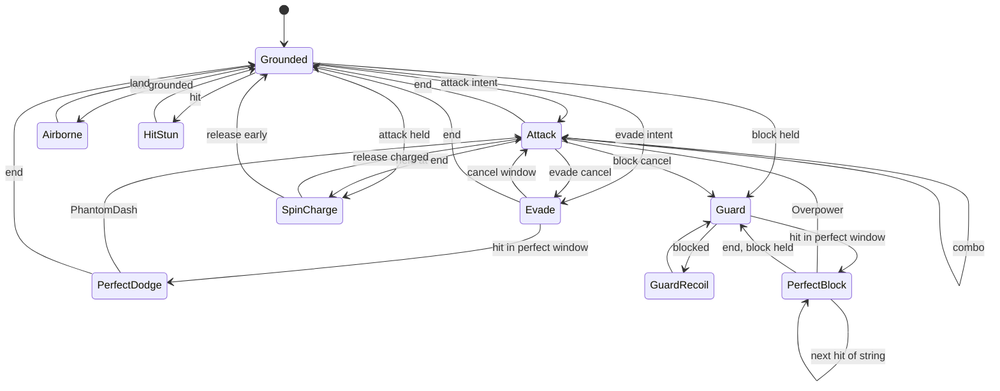

# kiRa: architecture

Third-person katana combat core. Moveset inspired by *Twilight Princess* (Z-targeting, contextual evades, directional slashes, spin attack), with a *Stellar Blade* layer on top (perfect dodge, perfect block, counters, slow motion).

The gameplay core is plain TypeScript with zero engine dependencies. Rendering, physics and audio plug in through small interfaces, so the same code runs in the headless test sandbox, a Three.js browser build, or a port to Unity/Godot.

---

## 1. Modules

| Module | Folder | Owns | Knows about |
|---|---|---|---|
| **Core** | `src/core` | math, `EventBus`, `TimeController` (slow-mo, hit stop) | nothing |
| **Input** | `src/input` | device-agnostic actions, `InputBuffer` (presses, holds, 360 gesture) | core |
| **Targeting** | `src/targeting` | Z-target lock state, target selection | input, core |
| **Combat** | `src/combat` | move definitions, direction math, `IntentResolver` (button-to-move table), `CombatWorld` (hit overlap, both directions), `Enemy` + `Poise` | input, core, player contracts |
| **Enemies** | `src/enemies` | attack strings as data, `TrainingDummyAI` | combat (Enemy) |
| **Player** | `src/player` | `PlayerController`, FSM states, hit resolution | interfaces only |
| **Physics** | `src/physics` | `CharacterMotor` implementations (capsule, gravity) | player contracts |
| **Feel** | `src/feel` | `CombatFeel`: events in, time effects + FX cues out | events, time |
| **Camera** | `src/camera` | orbit + lock-on rig, spring arm, event reactions (engine-free, outputs a pose) | targeting, fx cues |
| **Character** | `src/character` | rig, clips (animation as data), forward kinematics for floor contact | moves, tuning |
| **Render adapter** | `src/render` *(to build)* | Three.js scene, animator, `FxSink` | everything above, read-only |

### Dependency rules

```
input ──► combat/IntentResolver ──► player FSM ──► (motor, animator, combat sink)  [interfaces]
                                         │
                                         └──► EventBus ──► feel, camera, audio, UI
```

- The player FSM never imports a renderer, a camera or a concrete motor. It talks to `PlayerContext` interfaces.
- Spectacle (slow-mo, VFX, camera punches, sound) is **only** triggered by events. Gameplay timing never waits on presentation.
- Nothing in gameplay reads a key code. Devices map to `Action` values.

---

## 2. Frame order

```
time.update(realDt)
input.update(sample at REAL time)           // buffer windows never stretch in slow-mo
targeting.update()
player.update(realDt * time.playerScale)
motor.step(realDt * time.playerScale)
enemies.update(realDt * time.worldScale)
combat overlap tests -> player.receiveHit() / enemy.receiveHit()
feel.update()
camera.update(realDt)                       // camera stays smooth during slow-mo
render
```

Three clocks:

| Clock | Drives | Why |
|---|---|---|
| Real | input buffer, camera, UI | timing windows feel identical to the thumbs, camera stays fluid |
| Player | player FSM, her motor, her animations | she moves faster than the world during slow-mo |
| World | enemies, projectiles, particles | the slow-mo effect |

---

## 3. Player FSM

Flat FSM with data-driven parameterized states. Variants (which slash, which evade) are data, so adding a move is a table entry.

| State | Variants / sub-modes | Enters from | Exits to | Defense |
|---|---|---|---|---|
| `Grounded` | Idle, Run, Strafe (animator blend param) | most states on finish | Attack, Evade, Guard, SpinCharge, Airborne | none |
| `Airborne` | Fall | Grounded off a ledge, evades that end mid-air | Grounded on land | none |
| `Attack` | Horizontal, ReverseHorizontal, Vertical, Thrust, Spin, JumpAttack, PhantomDash, Overpower | Grounded, Attack (combo), Evade (cancel), SpinCharge, PerfectDodge, PerfectBlock | Attack, Evade, Guard, SpinCharge, Grounded | counters are invulnerable |
| `Evade` | Roll, SideHopLeft, SideHopRight, Backflip | Grounded, Attack, Guard, SpinCharge, PerfectBlock | Attack, Evade, Grounded, Airborne | i-frames, **perfect window** |
| `SpinCharge` | | Attack end with button held, Grounded with long hold | Attack(Spin), Grounded, Guard, Evade | none |
| `Guard` | | Grounded, Attack (block cancel), GuardRecoil | Grounded, Evade | frontal block, **perfect window** |
| `GuardRecoil` | | `receiveHit` (blocked) | Guard, Grounded | frontal block |
| `HitStun` | | `receiveHit` (hit) | Grounded, Airborne | none |
| `PerfectDodge` | flourish per evade type | `receiveHit` during perfect window | Attack(PhantomDash), Grounded, Airborne | invulnerable |
| `PerfectBlock` | alternating clash poses, chain count | `receiveHit` during perfect window | Attack(Overpower), Evade, Guard, Grounded | perfect block (chains) |



### Attack timeline

```
|-- startup --|-- active --|------ recovery ------|
       comboOpen ^      evadeCancel ^   blockCancel ^
```

Every field lives in `src/combat/moves.ts`. The hitbox is only live during `active`.

### Hit resolution (`PlayerController.receiveHit`)

```
perfect dodge window?        -> PerfectDodge   (works on unblockable attacks too)
invulnerable?                -> evaded
guarding and hit is frontal?
    perfect block window?    -> PerfectBlock   (attacker is parried + takes poise damage)
    otherwise                -> GuardRecoil
otherwise                    -> HitStun
```

---

## 4. Input to move table

All of this lives in `resolveIntent()` (`src/combat/IntentResolver.ts`). Directions are relative to her facing, sampled when the button was pressed. An attack input picks a swing family; the combo table in `moves.ts` (`COMBO`) picks the swing.

| Input | Untargeted | Targeted |
|---|---|---|
| Attack | Horizontal family | Vertical family |
| Forward + Attack | Vertical family | Thrust family |
| Right + Attack | Reverse family (opens sweeping left to right) | Reverse family |
| Left / Back + Attack | Horizontal family (opens sweeping right to left) | Horizontal family |
| Attack in combo window | the family's next swing (below) | same |
| Hold Attack, release when charged | Spin | Spin |
| 360 stick + Attack | Spin | Spin |
| Evade | Forward roll (stick dir) | Jump attack (no rolling while locked on) |
| Forward + Evade | Roll | Jump attack |
| Left / Right + Evade | Roll | Side hop |
| Back + Evade | Roll | Backflip |
| Block (held) | Guard | Guard |
| Evade, hit lands in first 0.15 s | Perfect dodge → Attack = Phantom Dash | same |
| Block pressed, hit lands in first 0.12 s | Perfect block → Attack = Overpower | same |

Tunable: `untargetedFrame: 'camera'` makes untargeted Forward/Left relative to the camera instead of her facing.

### Combos

A combo is up to `maxCombo` (4) swings. Repeating an input never repeats the same swing: every swing records which side the blade finishes on (`AttackDef.endSide`), and the next one starts from there. The 4th swing is the family's ender, picked by the input of that 4th press.

| Family | Opener | Next swing, blade on her right | Next swing, blade on her left | 4th hit (ender) |
|---|---|---|---|---|
| Horizontal | Horizontal (forehand) | Horizontal | Reverse horizontal (backhand) | Spin: one full-turn cut |
| Reverse | Reverse horizontal | Horizontal | Reverse horizontal | Rising: diagonal cut up and through, with a hop |
| Vertical | Vertical `/` | Vertical `/` | Vertical left `\` | Cleave: leaping two-handed overhead, lands on one knee |
| Thrust | Thrust (right hip) | Thrust | Thrust left (across the left hip) | Lunge: long driving stab |

So neutral x4 is forehand, backhand, forehand, spin. Forward x4 is `/`, `\`, `/`, cleave. Mixed inputs flow the same way: a forehand ends on her left, so Forward next gives `\` from the left shoulder. Enders have `comboOpen: Infinity`, so a press during one starts a fresh combo once it ends. Letting any swing finish resets the count. `test/combo.test.ts` covers all of it, and `test/slashDirection.test.ts` checks each animation ends on the side its `endSide` claims.

---

## 5. Input buffer

`src/input/InputBuffer.ts` records, it never interprets.

| Feature | Default | Notes |
|---|---|---|
| Buffer window | 0.2 s (12 frames) | a press during recovery fires on the first legal frame |
| Stick snapshot | per press | "Right + Attack" stays Right even if the stick moved before the attack could fire |
| 360 gesture | 306° net sweep within 0.5 s | dropping through the center resets it; wiggles cancel out |
| Hold timing | `heldFor(action)` | charge spin, perfect block window |
| Press gap | `pressGap(action)` | anti-mash for perfect block |
| Flush | on hit stun and perfect states | panic mashing never fires stale moves |

---

## 6. Perfect dodge and perfect block

**Detection is at hit time.** A state reports a `Defense` with optional `perfectDodge` / `perfectBlock` flags. `receiveHit` checks them in priority order. No separate threat system is needed, as long as the combat module tests evading players against a slightly inflated hurtbox (graze margin, about 0.75 m) so near misses count.

| | Perfect dodge | Perfect block |
|---|---|---|
| Window | hit lands ≤ 0.15 s after evade starts | hit lands ≤ 0.12 s after Block press |
| Anti-abuse | evade commitment | re-pressing Block within 0.35 s voids the window |
| Player result | acrobatic flourish (per evade type), invulnerable | clash pose, steps INTO the enemy, chains on multi-hit strings |
| Enemy result | nothing (she wasn't hit) | parried (weapon thrown back, swing cancelled) + poise damage. Poise full = stagger. |
| Time | world 15%, player 55% for 0.55 s, eases out 0.35 s | 0.07 s hit stop, then world 35% / player 80% |
| Counter | Attack → **Phantom Dash** (blur dash slash, 9 m reach, invulnerable, 35 poise) | Attack → **Overpower** (heavy strike, invulnerable, 60 poise) |
| Counter input | latched: an early press waits for the counter window | same |

Counters call `TimeController.clear()` and release her to full speed while the world stays slow for a beat.

---

## 7. Camera

**Free orbit:** yaw/pitch from right stick or mouse, spring arm with collision raycast, critically damped follow on a point above her shoulders.

**Lock-on:**
- Focus = lerp(player, target, 0.35), raised to chest height.
- Yaw sits behind the player along the player-to-target line, offset slightly so she sits on the left third of the frame.
- Distance = base + separation × k, clamped, so both stay in frame as they spread apart.
- When the lock breaks, ease back to orbit over about 0.3 s. Never snap.
- `targeting.wantsRecenter` (button held, nothing in range): swing behind her.

**Event hooks:** `perfectDodge` → FOV punch out + slight dutch roll. `perfectBlock` → short shake + push in. `counter.*` → quick dolly toward the action.

The camera runs on real time, so it stays smooth while the world crawls.

---

## 8. Hair

On the skinned base mesh (the default body) she has the mesh's own head with a 2B-style side-parted bob: one rigid shell on the head, no simulation (`src/character/hairFit.ts`). The modeled anime head (`src/render/AnimeHead.ts`, `public/models/anime_head.glb`) sits on the classic body and can come back on the mesh body by cutting its neck (`keepHead: false`). The previous sculpted faceless head and its chin-length bob (`src/render/HeadSculpt.ts`: one shell plus locks laid over it) can be restored from commit 8ee94d3. A ponytail verlet chain (`src/character/Ponytail.ts`, 120 Hz substeps on the player clock, follow-the-leader lengths, collision spheres) lived here until the redesign; restore it from commit 224c1c5 if a longer style comes back.

---

## 9. Porting

| Concept | Unity | Godot 4 |
|---|---|---|
| `CharacterMotor` | `CharacterController` wrapper | `CharacterBody3D` wrapper |
| `EventBus` | C# events / ScriptableObject channels | signals |
| `TimeController` | per-system `deltaTime` multipliers (do not touch `Time.timeScale`) | per-node multipliers |
| States | plain C# classes, same layout | `RefCounted` classes |
| Move tables | ScriptableObjects | Resources |
